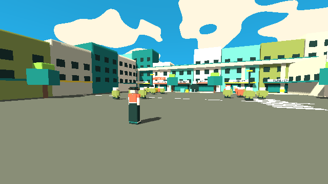

# Game Lab 2

低多邊形（Low-poly）街頭動作 RPG。四名可選角色、單人遊玩；目前可玩原型為 Jax。個人開發項目。

## 現行美術方向（2026-11-04）

依 Alan 最新指示，全案跟隨 [Drive 參考](https://drive.google.com/drive/folders/1VVc1FFVGtFLM5OatUtT8dPYhKbnIB7pb)：日曬街區、青藍天空白雲、暖白混凝土、青綠鐵構、珊瑚與亮黃重點色、低多邊形街服人物及卡通明暗。此決定取代先前藍紫夜城／霓虹基調。世界觀、角色色票、資產、教學、街景、敵人、HUD 與 Jax 生成器均依此同步。

AI 接手先讀 [美術指南](docs/art/style-guide.md) → [角色](docs/design/characters.md) → [世界觀](docs/design/world.md) → [資產規格](docs/art/asset-spec.md)。角色剪裁與身份保持各自差異；不得從舊版恢復已替換色票。

目前包含四個據點、17 隻敵人、一個頭目與卡匣工作臺；完整第一區敘事及另外三名角色尚未完成。參考影片是視覺來源，eon_OS 未檢視，音訊未分析。

最新引擎畫面（原型，非概念圖）：

[遊玩畫面](docs/art/gameplay-preview.png) · [工作臺](docs/art/bench-preview.png) · [Jax 三視圖](docs/art/jax-preview.png)

## 資料夾結構（固定，不要隨便增加新層）

| 資料夾 | 存放內容 |
|---|---|
| `docs/design/` | 企劃、角色設定、玩法、劇情（文字文件） |
| `docs/art/` | 美術風格指南、參考分析、三視圖與表情稿說明 |
| `docs/guides/` | 逐步教學（安裝工具、做第一個場景等） |
| `assets/characters/` | 角色模型、貼圖、動畫（Blender 輸出的檔案） |
| `assets/environment/` | 街道、建築、道具模型 |
| `assets/audio/` | 音效、音樂 |
| `game/` | 遊戲場景與腳本（Godot） |
| 根目錄 `project.godot` | Godot 專案檔（放在根目錄才讀得到 `assets/`） |
| `tools/` | 小腳本、輔助工具（例如 `tools/blender/` 模型生成腳本） |

## 現有文件

- [CLAUDE.md](CLAUDE.md) — AI 工作指引入口（必讀順序、JSR 目標、分階段規則）
- `game/scenes/jsr-test.tscn` — JSR 風格獨立測試場景（驗收畫面在 `docs/art/jsr/`）
- [美術風格與 AI 交接指南](docs/art/style-guide.md) — 已確立規格、Drive 參考分析、三種參考提示詞、技術術語、Blender／Godot 流程與待辦；AI 接手美術工作先讀頂部優先順序（2026-11-04 更新）
- `docs/art/slumlordz-sandwich.mp4`、`docs/art/ice-cream.mp4` — 美術與整體感覺參考影片
- `docs/art/asset-spec.md` — 換模型與場景的資產規格
- `docs/design/world.md` — 世界觀（疊域、勢力、衝突、反社會基調、命名規則）
- `docs/design/first-district.md` — 第一區橋底街流程（開場、教學戰、頭目、結算選擇）
- `docs/design/differentiation-ideas.md` — 與 PoE2 的差異化研究與構想（草案）
- `docs/design/characters.md` — 四人角色設定（唯一來源，含背景、口吻、成長弧線）
- `docs/design/game-plan.md` — 企劃草案、待決定問題、工具路線
- `docs/guides/godot-setup.md` — 安裝 Godot、開啟並試玩 Jax 試玩版

## 規則

1. **一個主題一個檔案**，更新舊檔，不要另開新版本（版本記錄交給 git）。
2. 新增檔案前，先看上面的表，放入對應資料夾。
3. 檔名全部使用小寫英文，用 `-` 連接，例如 `jax-idle.blend`、`street-lamp.glb`。角色檔名前綴用角色名：`jax-`、`vee-`、`skye-`、`niko-`。
4. 參考影片（mp4）放在 `docs/art/`（Alan 2026-10-30 同意；單檔建議 50MB 以下，更大的仍留在 Google Drive `Game Lab 2` 資料夾）。
5. 已決定的重要事項，記在對應文檔的頂部。
6. 全部文檔與遊戲內文字一律使用書面語，不使用粵語或港式用字（Alan 2026-10-30 要求）。
